# Assignment 1 planning diagram

This diagram shows the intended sequence for Nico's Elite Ball Knowledge as of 2026-09-29. Completed boxes reflect the local repository; future dates are targets, not claims of completed work.

```mermaid
flowchart LR
    A[23 Sep<br/>Scope, repository,<br/>Flask foundation<br/>DONE] --> B[28 Sep<br/>Kelly calculator,<br/>SQLite foundation<br/>DONE]
    B --> C[29 Sep<br/>Deposits and balance<br/>backend done, page next]
    C --> D[30 Sep<br/>Journal schema,<br/>matches and odds<br/>PLANNED]
    D --> E[1 Oct<br/>Probability estimates<br/>and bet decisions<br/>PLANNED]
    E --> F[2 Oct<br/>Stake limits and<br/>settlement<br/>PLANNED]
    F --> G[3 Oct<br/>Tests, five ADRs,<br/>AI log, report diagrams<br/>PLANNED]
    G --> H[4 Oct<br/>Final verification and<br/>submission by 23:59<br/>PLANNED]

    classDef completed fill:#e8f5e9,stroke:#2e7d32,color:#1b5e20;
    classDef current fill:#fff3e0,stroke:#e65100,color:#4e342e;
    classDef future fill:#f5f5f5,stroke:#757575,color:#212121;
    class A,B completed;
    class C current;
    class D,E,F,G,H future;
```

The build is incremental: each feature should have a test, a clear commit, and an entry in the AI usage log when AI contributes. The report's architecture and database diagrams must be created from the final implemented code and schema.

Current state on 2026-09-29: seven pushed meaningful commits across two dates; 19 passing tests and 96% coverage of the code measured so far. The new deposit and balance code is still uncommitted. The assignment requires at least 12 commits across six distinct dates and at least 70% coverage of the final core business logic in both domains.
